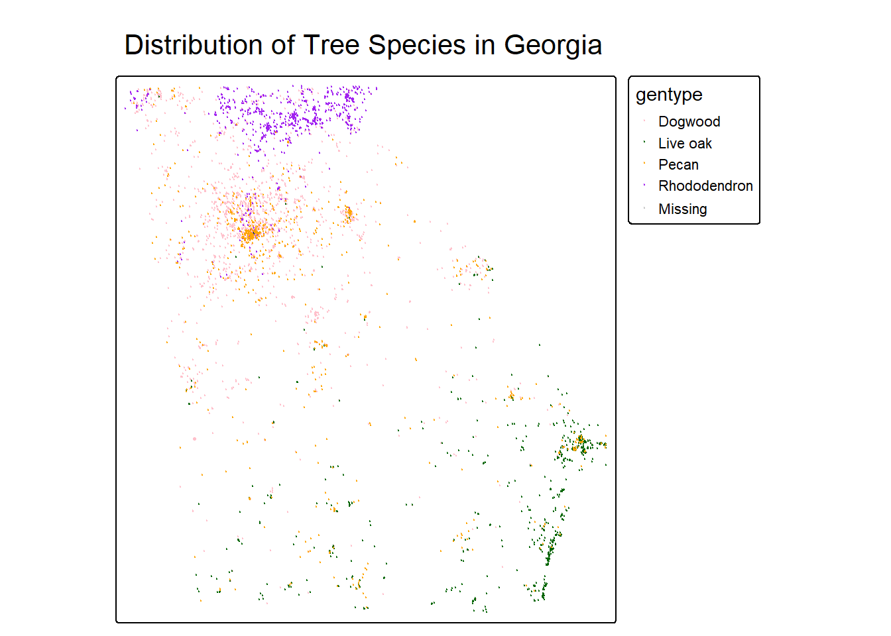
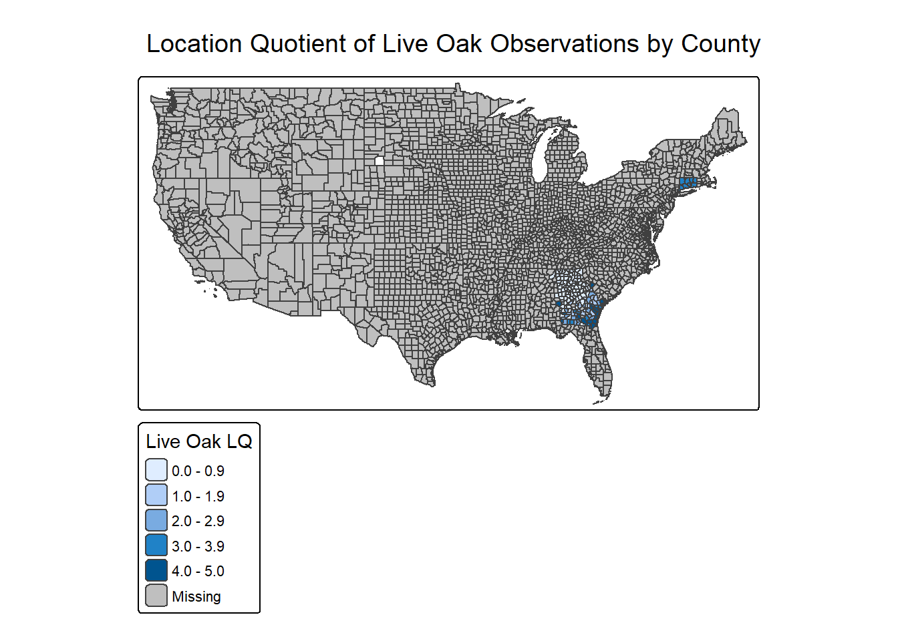
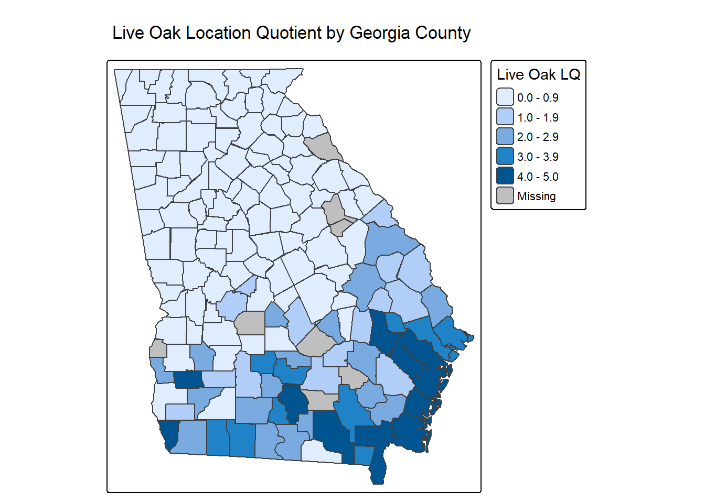
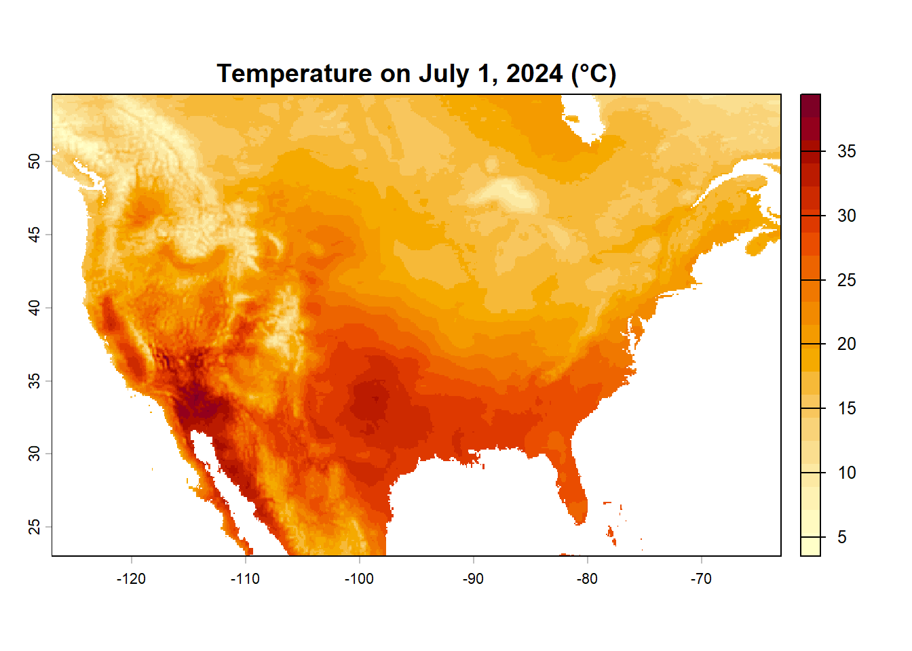
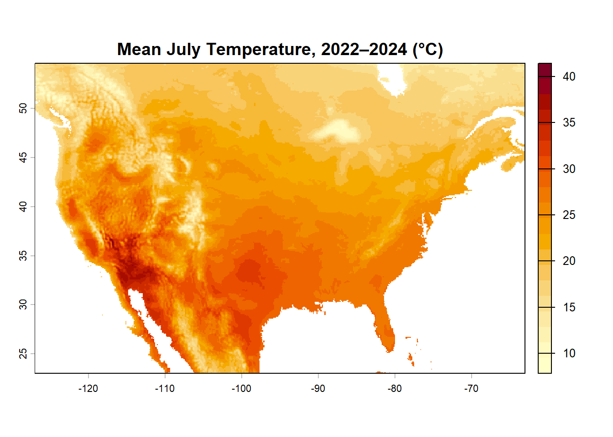
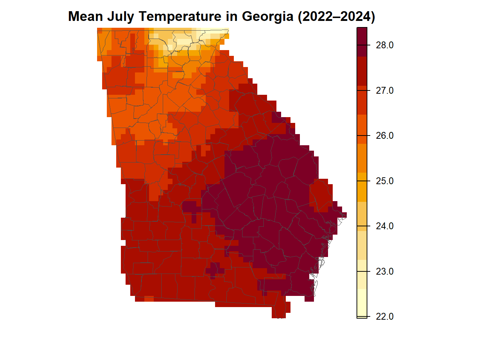

# Spatial statistics with vector and raster data

**Overview:**

In this lab, you'll work with point, polygon, and raster data to investigate the distribution and environmental characteristics of trees in Georgia.

You'll begin with observations of two tree species collected through the iNaturalist citizen-science platform. First, you'll use these observations to calculate the number of trees of each species found in Georgia's counties. You'll then use these counts to calculate a **location quotient (LQ)**, a measure that compares the prevalence of a species in each county with its prevalence across the state as a whole.

In the second part of the lab, you'll use temperature data from the ERA5 climate reanalysis to investigate the temperatures associated with observations of the two tree species. You'll extract temperature values from a raster for each tree observation and then calculate descriptive statistics for each species.

The ERA5 data we are using were obtained through the Google Earth Engine platform. More information is available at <https://github.com/communitymaplab/era5_1950-69_2014-2024>.

For this lab to be marked complete, the following criteria must be met:

* Your responses should show your ability to load and manipulate point and polygon vector data. (Tasks 1–3)
* Your responses should show your ability to calculate counts and create new variables from spatial data. (Tasks 2–4)
* Your responses should show your understanding of the location quotient as a measure of spatial concentration. (Tasks 4–5)
* Your responses should show your ability to load raster data and extract raster values at point locations. (Tasks 6–8)
* Your responses should show your ability to manipulate data frames and calculate summary statistics. (Tasks 9–10)
* Your responses should demonstrate your ability to describe statistical and spatial patterns in geographic data.

Before you get started, you'll need to load the following packages: `tidyverse`, `terra`, `sf`, and `tmap`. You may also want to use `knitr` for displaying tables.


::: {.cell}

```{.r .cell-code}
# Load packages here.
library(tidyverse)
```

::: {.cell-output .cell-output-stderr}

```
── Attaching core tidyverse packages ──────────────────────── tidyverse 2.0.0 ──
✔ dplyr     1.2.1     ✔ readr     2.2.0
✔ forcats   1.0.1     ✔ stringr   1.6.0
✔ ggplot2   4.0.3     ✔ tibble    3.3.1
✔ lubridate 1.9.5     ✔ tidyr     1.3.2
✔ purrr     1.2.2     
── Conflicts ────────────────────────────────────────── tidyverse_conflicts() ──
✖ dplyr::filter() masks stats::filter()
✖ dplyr::lag()    masks stats::lag()
ℹ Use the conflicted package (<http://conflicted.r-lib.org/>) to force all conflicts to become errors
```


:::

```{.r .cell-code}
library(terra)
```

::: {.cell-output .cell-output-stderr}

```
terra 1.9.46

Attaching package: 'terra'

The following object is masked from 'package:tidyr':

    extract
```


:::

```{.r .cell-code}
library(sf)
```

::: {.cell-output .cell-output-stderr}

```
Linking to GEOS 3.14.1, GDAL 3.12.1, PROJ 9.7.1; sf_use_s2() is TRUE
```


:::

```{.r .cell-code}
library(tmap)
```

::: {.cell-output .cell-output-stderr}

```
Registered S3 method overwritten by 'stars':
  method                  from
  st_interpolate_aw.stars sf  
```


:::

```{.r .cell-code}
library(knitr)
```

::: {.cell-output .cell-output-stderr}

```

Attaching package: 'knitr'

The following object is masked from 'package:terra':

    spin
```


:::
:::


# Part 1: Mapping the distribution of trees

## Where are these tree species most prevalent in Georgia?

In this part of the lab, you'll use iNaturalist observations of two tree species to investigate their geographic distribution.

The data folder contains a file named `gatree_obs_inat.csv`. This file contains observations of live oaks, pecan trees, flowering dogwoods, and great rhododendrons in Georgia.

Your first task is to load these observations and convert them into a spatial point dataset. The observations contain longitude and latitude coordinates that you can use to create the point locations.

### Task 1

**Load the iNaturalist observations and convert them to an `sf` point dataset using the longitude and latitude fields. Map the observations using `tmap`, with the point colors based on the `gentype` field.**


::: {.cell}

```{.r .cell-code}
# Load the iNaturalist observations
tree_obs <- read_csv("data/gatree_obs_inat.csv")
```

::: {.cell-output .cell-output-stderr}

```
Rows: 6322 Columns: 19
── Column specification ────────────────────────────────────────────────────────
Delimiter: ","
chr  (13): uuid, observed_on_string, time_observed_at, time_zone, user_login...
dbl   (5): id, user_id, taxon_id, longitude, latitude
date  (1): observed_on

ℹ Use `spec()` to retrieve the full column specification for this data.
ℹ Specify the column types or set `show_col_types = FALSE` to quiet this message.
```


:::

```{.r .cell-code}
# Convert observations to spatial points
tree_sf <- st_as_sf(
  tree_obs,
  coords = c("longitude", "latitude"),
  crs = 4326
)

# Remove missing species observations
tree_sf_filtered <- tree_sf %>%
  mutate(gentype = trimws(as.character(gentype))) %>%
  filter(
    !is.na(gentype),
    gentype != "",
    tolower(gentype) != "missing"
  )

# Map the four tree species with different colors
tm_shape(tree_sf_filtered) +
  tm_dots(
    col = "gentype",
    palette = c(
      "Dogwood" = "pink",
      "Live oak" = "darkgreen",
      "Pecan" = "orange",
      "Rhododendron" = "purple"
    ),
    size = 0.06
  ) +
  tm_layout(
    main.title = "Distribution of Tree Species in Georgia",
    main.title.position = "center",
    legend.outside = TRUE
  )
```

::: {.cell-output .cell-output-stderr}

```

── tmap v3 code detected ───────────────────────────────────────────────────────
[v3->v4] `tm_tm_dots()`: migrate the argument(s) related to the scale of the
map variable `fill` namely 'palette' (rename to 'values') to fill.scale =
tm_scale(<HERE>).[v3->v4] `tm_dots()`: use 'fill' for the fill color of polygons/symbols
(instead of 'col'), and 'col' for the outlines (instead of 'border.col').[v3->v4] `tm_layout()`: use `tm_title()` instead of `tm_layout(main.title = )`
```


:::

::: {.cell-output-display}
{width=672}
:::

```{.r .cell-code}
#table(tree_sf_filtered$gentype, useNA = "ifany")

#packageVersion("tmap")

# I left these two comments in as part of my failed troubleshoot to drop the label of "Missing" from the plot legend. There is no missing data, but I cannot for the life of me figure out how to remove that from the image. I tried for at least one hour to do this to no avail.
```
:::


---

Now that you have mapped the observations, you'll use the Georgia county boundaries to determine how many observations of each species occur within each county.

Load the county data from:

`ACSCtyData_2022ACS_simplify.gpkg`

You'll then use a spatial join to determine which county contains each tree observation.

### Task 2

**Load the Georgia county dataset and use a spatial join to assign each tree observation to a county. Create a table showing the number of observations of each species in each county.**


::: {.cell}

```{.r .cell-code}
# Load the county boundaries
ga_counties <- st_read("data/ACSCtyData_2022ACS_simplify.gpkg")
```

::: {.cell-output .cell-output-stdout}

```
Reading layer `ACSCtyData_2022ACS_simplify' from data source 
  `C:\Users\dj98x\Documents\GitHub\David-Lab2-Repo\data\ACSCtyData_2022ACS_simplify.gpkg' 
  using driver `GPKG'
Simple feature collection with 3107 features and 65 fields
Geometry type: MULTIPOLYGON
Dimension:     XY
Bounding box:  xmin: -124.7322 ymin: 24.54423 xmax: -66.96015 ymax: 49.38437
Geodetic CRS:  WGS 84
```


:::

```{.r .cell-code}
# Make sure both datasets use the same coordinate system
ga_counties <- st_transform(ga_counties, st_crs(tree_sf))

# Assign each tree observation to a county
tree_counties <- st_join(
  tree_sf,
  ga_counties,
  join = st_within,
  left = TRUE
)

# Count observations of each species in each county
county_species_counts <- tree_counties %>%
  st_drop_geometry() %>%
  count(cty_name, gentype, name = "n_observations") %>%
  arrange(cty_name, gentype)

# Reshape the table so each species has its own column
county_species_wide <- county_species_counts %>%
  pivot_wider(
    names_from = gentype,
    values_from = n_observations,
    values_fill = 0
  )

# Display the wider table
county_species_wide
```

::: {.cell-output .cell-output-stdout}

```
# A tibble: 161 × 5
   cty_name                        Dogwood `Live oak` Pecan Rhododendron
   <chr>                             <int>      <int> <int>        <int>
 1 Appling County, Georgia               2          4     1            0
 2 Baker County, Georgia                 7         10     0            0
 3 Baldwin County, Georgia               5          3     9            0
 4 Banks County, Georgia                 6          0     0            1
 5 Barrow County, Georgia               39          0     5            0
 6 Bartow County, Georgia               40          0     3            0
 7 Beaufort County, South Carolina       0          1     0            0
 8 Ben Hill County, Georgia              0          1     1            0
 9 Berrien County, Georgia               0          5     0            0
10 Bibb County, Georgia                 16          3    19            0
# ℹ 151 more rows
```


:::
:::


You should now have a dataset showing the number of observations of each species in each county.

For example, your table might have a structure similar to:

| County | Live oak | Great rhododendron |
|---|---:|---:|
| Clarke | 25 | 8 |
| Oconee | 17 | 12 |
| ... | ... | ... |

Your next step is to calculate the **total number of tree observations** in each county.

### Task 3

**Create a county-level dataset containing the number of observations of each species and the total number of tree observations.**


::: {.cell}

```{.r .cell-code}
# Create a county-level dataset with species counts and totals
county_tree_totals <- county_species_wide %>%
  mutate(
    total_observations = rowSums(
      across(where(is.numeric)),
      na.rm = TRUE
    )
  )

# Display the results
county_tree_totals
```

::: {.cell-output .cell-output-stdout}

```
# A tibble: 161 × 6
   cty_name             Dogwood `Live oak` Pecan Rhododendron total_observations
   <chr>                  <int>      <int> <int>        <int>              <dbl>
 1 Appling County, Geo…       2          4     1            0                  7
 2 Baker County, Georg…       7         10     0            0                 17
 3 Baldwin County, Geo…       5          3     9            0                 17
 4 Banks County, Georg…       6          0     0            1                  7
 5 Barrow County, Geor…      39          0     5            0                 44
 6 Bartow County, Geor…      40          0     3            0                 43
 7 Beaufort County, So…       0          1     0            0                  1
 8 Ben Hill County, Ge…       0          1     1            0                  2
 9 Berrien County, Geo…       0          5     0            0                  5
10 Bibb County, Georgia      16          3    19            0                 38
# ℹ 151 more rows
```


:::
:::


## Calculating a location quotient

You will now use these counts to calculate a **location quotient (LQ)**. For this lab, we'll use it to ask:

> **Is a particular tree species more prevalent among tree observations in a county than it is across Georgia as a whole?**

For this lab, calculate an LQ for **live oak observations**.

First, calculate the statewide proportion of observations that are live oak. Then calculate the proportion of observations that are live oak in each county. Finally, divide the county proportion by the statewide proportion.

### Task 4

**Calculate the location quotient for live oak observations for every Georgia county. Add the resulting LQ as a new variable in your county dataset.**


::: {.cell}

```{.r .cell-code}
# Calculate the statewide proportion of live oak observations
statewide_live_oak_prop <- sum(county_tree_totals$`Live oak`, na.rm = TRUE) /
  sum(county_tree_totals$total_observations, na.rm = TRUE)

# Calculate the location quotient for each county
county_tree_totals <- county_tree_totals %>%
  mutate(
    live_oak_prop = `Live oak` / total_observations,
    Live_oak_LQ = live_oak_prop / statewide_live_oak_prop
  )

# Display the results
county_tree_totals %>%
  select(cty_name, `Live oak`, total_observations, Live_oak_LQ)
```

::: {.cell-output .cell-output-stdout}

```
# A tibble: 161 × 4
   cty_name                        `Live oak` total_observations Live_oak_LQ
   <chr>                                <int>              <dbl>       <dbl>
 1 Appling County, Georgia                  4                  7       2.73 
 2 Baker County, Georgia                   10                 17       2.81 
 3 Baldwin County, Georgia                  3                 17       0.843
 4 Banks County, Georgia                    0                  7       0    
 5 Barrow County, Georgia                   0                 44       0    
 6 Bartow County, Georgia                   0                 43       0    
 7 Beaufort County, South Carolina          1                  1       4.78 
 8 Ben Hill County, Georgia                 1                  2       2.39 
 9 Berrien County, Georgia                  5                  5       4.78 
10 Bibb County, Georgia                     3                 38       0.377
# ℹ 151 more rows
```


:::
:::


Now map your LQ values.

### Task 5

**Create a map showing the location quotient for live oak observations. Describe the geographic pattern you see. Which parts of Georgia have relatively high concentrations of live oak observations? Which have relatively low concentrations?**


::: {.cell}

```{.r .cell-code}
# Join the county LQ data to the Georgia county polygons
ga_counties_lq <- ga_counties %>%
  left_join(
    st_drop_geometry(county_tree_totals) %>%
      select(cty_name, Live_oak_LQ),
    by = "cty_name"
  )

# Map the live oak location quotient
tm_shape(ga_counties_lq) +
  tm_polygons(
    fill = "Live_oak_LQ",
    fill.scale = tm_scale_intervals(
      style = "pretty"
    ),
    fill.legend = tm_legend(
      title = "Live Oak LQ"
    )
  ) +
  tm_title("Location Quotient of Live Oak Observations by County") +
  tm_layout(legend.outside = TRUE)
```

::: {.cell-output-display}
{width=672}
:::

```{.r .cell-code}
# Keep only Georgia counties
ga_counties_only <- ga_counties %>%
  filter(st_name == "Georgia")

# Join the live oak LQ values to the county polygons
ga_counties_lq <- ga_counties_only %>%
  left_join(
    st_drop_geometry(county_tree_totals) %>%
      select(cty_name, Live_oak_LQ),
    by = "cty_name"
  )

# Map live oak location quotients
tm_shape(ga_counties_lq) +
  tm_polygons(
    fill = "Live_oak_LQ",
    fill.scale = tm_scale_intervals(style = "pretty"),
    fill.legend = tm_legend(title = "Live Oak LQ")
  ) +
  tm_title("Live Oak Location Quotient by Georgia County") +
  tm_layout(legend.outside = TRUE)
```

::: {.cell-output .cell-output-stderr}

```
[plot mode] fit legend/component: Some legend items or map compoments do not
fit well, and are therefore rescaled.
ℹ Set the tmap option `component.autoscale = FALSE` to disable rescaling.
```


:::

::: {.cell-output-display}
{width=672}
:::
:::


**Your response:**

{

Interestingly, in the US map there was a noted amount of live oak trees in western Massachusetts! But primarily, it appears as though this tree (mostly) neatly finds itself located in Georgia, in practically all counties, and a small amount of surrounding states' counties. Of the Georgia counties in which it is located, it appears most frequently in the coastal and southern stretches of the state, and it is comparatively sparse in the central and northern regions. I wonder if county boundaries are really the best way of looking at this, as opposed to natural geographic features and biomes. That said, one can get a decent idea of what sort of environment the live oak tree appears to enjoy from looking at this map (wet, flat land; hot and humid summers, moderate and dry winters).

}

# Part 2: Trees and temperature in Georgia

## What temperatures are associated with observations of each species?

In the second part of the lab, you'll investigate the environmental characteristics of the four tree species.

The temperature data you'll use come from the ERA5 climate reanalysis. The data provide retrospective information about atmospheric conditions across the globe.

You will use the July temperature rasters from 2022–2024 to calculate a mean July temperature raster. You'll then extract the temperature associated with each tree observation.

Your first step is to load one of the temperature rasters—the one for July 1, 2024—and convert the temperature from degrees Kelvin to degrees Celsius.

You should see this raster in the data folder of this lab repository. Load it using the `rast` function from `terra`.

### Task 6

**Load the July 1, 2024 temperature raster and convert it from Kelvin to Celsius. Plot it when you are done.**


::: {.cell}

```{.r .cell-code}
# Load the July 1, 2024 temperature raster
temp_2024 <- rast("data/temp_july2022_2024/temperature_2m_2024-07-01.tif")

# Convert temperature from Kelvin to Celsius
temp_2024_c <- temp_2024 - 273.15

# Plot the temperature raster
plot(
  temp_2024_c,
  main = "Temperature on July 1, 2024 (°C)",
  col = hcl.colors(20, palette = "YlOrRd", rev = TRUE)
)
```

::: {.cell-output-display}
{width=672}
:::
:::


Now load **all of the temperature rasters for July 2022–2024**.

Create a list of the files in the `temp_july2022_2024` folder and load them using `rast`. Convert the values from Kelvin to Celsius.

Use `nlyr()` to confirm how many raster layers you have loaded.

### Task 7

**Load all temperature rasters for July dates in 2022–2024, convert them from Kelvin to Celsius, and calculate the mean temperature across all of the raster layers.**


::: {.cell}

```{.r .cell-code}
# List all temperature raster files
temp_files <- list.files(
  "data/temp_july2022_2024",
  pattern = "\\.tif$",
  full.names = TRUE
)

# Load all raster files
temp_stack <- rast(temp_files)

# Confirm the number of raster layers
nlyr(temp_stack)
```

::: {.cell-output .cell-output-stdout}

```
[1] 92
```


:::

```{.r .cell-code}
# Convert temperatures from Kelvin to Celsius
temp_stack_c <- temp_stack - 273.15

# Calculate the mean temperature across all raster layers
mean_temp_c <- mean(temp_stack_c, na.rm = TRUE) #na.rm = T ignores missing values

# Plot the mean July temperature
plot(
  mean_temp_c,
  main = "Mean July Temperature, 2022–2024 (°C)",
  col = hcl.colors(20, palette = "YlOrRd", rev = TRUE)
)
```

::: {.cell-output-display}
{width=672}
:::
:::


You now have a raster representing the mean July temperature across the study period.

Next, use `terra::extract()` to obtain the temperature value at the location of every tree observation.

### Task 8

**Extract the mean July temperature for each tree observation and add the temperature value to the tree dataset. Display the first several observations using `kable()`.**


::: {.cell}

```{.r .cell-code}
# Extract mean July temperature at each tree observation
tree_temp_values <- terra::extract(
  mean_temp_c,
  terra::vect(tree_sf)
)

# Add the extracted temperature to the tree dataset
tree_temp <- tree_sf %>%
  mutate(mean_july_temp = tree_temp_values[, 2])

# Display the first several observations
tree_temp %>%
  st_drop_geometry() %>%
  head() %>%
  knitr::kable(
    caption = "Tree Observations and Mean July Temperature (°C)",
    digits = 2
  )
```

::: {.cell-output-display}


Table: Tree Observations and Mean July Temperature (°C)

|     id|uuid                                 |observed_on_string                      |observed_on |time_observed_at        |time_zone                  | user_id|user_login      |user_name          |created_at              |updated_at              |quality_grade | taxon_id|species_guess     |scientific_name |common_name       |gentype | mean_july_temp|
|------:|:------------------------------------|:---------------------------------------|:-----------|:-----------------------|:--------------------------|-------:|:---------------|:------------------|:-----------------------|:-----------------------|:-------------|--------:|:-----------------|:---------------|:-----------------|:-------|--------------:|
|  38491|2be14d3a-d5c3-4d59-9a64-8ed5376f119f |November 7, 2011 6:29:23 PM EST         |2011-11-07  |2011-11-07 23:29:23 UTC |Eastern Time (US & Canada) |     935|petermayfield   |NA                 |2011-11-07 23:37:48 UTC |2025-12-16 11:41:35 UTC |research      |    54777|flowering dogwood |Cornus florida  |flowering dogwood |Dogwood |          26.63|
| 145616|bc4be566-7fb3-43a8-a672-01900fa1a402 |Fri Nov 09 2012 10:50:51 GMT-0500 (EST) |2012-11-09  |2012-11-09 15:50:51 UTC |Eastern Time (US & Canada) |    2179|charlie         |naturalist charlie |2012-11-09 21:13:47 UTC |2025-04-16 22:48:19 UTC |research      |    54777|flowering dogwood |Cornus florida  |flowering dogwood |Dogwood |          26.28|
| 399515|2b86ad80-77d9-4ce6-8965-546a82a69722 |2013-09-10                              |2013-09-10  |NA                      |Eastern Time (US & Canada) |   22176|lauralaneir     |NA                 |2013-09-16 09:29:29 UTC |2019-10-24 13:15:20 UTC |research      |    54777|flowering dogwood |Cornus florida  |flowering dogwood |Dogwood |          25.67|
| 618291|d3b145ff-3140-4d50-be18-66718b232a21 |Mon Apr 07 2014 16:05:11 GMT-0400 (EDT) |2014-04-07  |2014-04-07 20:05:11 UTC |Eastern Time (US & Canada) |   27509|richard_candler |Richard Candler    |2014-04-10 22:44:08 UTC |2014-10-20 18:13:02 UTC |research      |    54777|Flowering Dogwood |Cornus florida  |flowering dogwood |Dogwood |          26.41|
| 710549|9ba7a4c5-e68e-4b9c-94f7-792f8860f259 |2013-10-13 06:21:49                     |2013-10-13  |2013-10-13 10:21:49 UTC |Eastern Time (US & Canada) |     379|thall           |Tracy Hall         |2014-06-01 19:28:27 UTC |2025-04-16 23:04:02 UTC |research      |    54777|flowering dogwood |Cornus florida  |flowering dogwood |Dogwood |          26.40|
| 751374|fd172542-62b7-462d-bd96-43cee9cdfa11 |2014-04-06                              |2014-04-06  |NA                      |Eastern Time (US & Canada) |   19847|carolcummings   |NA                 |2014-06-23 20:40:07 UTC |2015-07-04 15:50:42 UTC |research      |    54777|Flowering Dogwood |Cornus florida  |flowering dogwood |Dogwood |          28.17|


:::

```{.r .cell-code}
#I wanted to create a map showing the Georgia Mean July Temp data

# Keep only Georgia counties
ga_only <- ga_counties %>%
  filter(st_name == "Georgia")

# Transform Georgia counties to the raster's coordinate system
ga_only <- st_transform(ga_only, crs(mean_temp_c))

# Crop the raster to Georgia's bounding box
ga_temp_crop <- terra::crop(
  mean_temp_c,
  terra::vect(ga_only)
)

# Mask everything outside Georgia's counties
ga_temp <- terra::mask(
  ga_temp_crop,
  terra::vect(ga_only)
)

# Plot Georgia's mean July temperature
plot(
  ga_temp,
  main = "Mean July Temperature in Georgia (2022–2024)",
  col = hcl.colors(10, palette = "YlOrRd", rev = TRUE), #I thought fewer colors would be visually more informative in this circumstance
  axes = FALSE
)

# Add Georgia county boundaries
plot(
  terra::vect(ga_only),
  add = TRUE,
  border = "gray30",
  lwd = 0.5
)
```

::: {.cell-output-display}
{width=672}
:::
:::


You can now calculate summary statistics for the two tree species.

For each species, calculate:

* the mean temperature
* the standard deviation of temperature
* the mean longitude
* the mean latitude

The mean longitude and latitude provide a simple measure of the **mean center** of the observations.

### Task 9

**Calculate the mean and standard deviation of temperature for each species, along with the mean longitude and latitude of their observations. Display the results using `kable()`.**


::: {.cell}

```{.r .cell-code}
# Calculate summary statistics for each tree species
tree_summary <- tree_temp %>%
  mutate(
    longitude = st_coordinates(.)[, 1],
    latitude = st_coordinates(.)[, 2]
  ) %>%
  st_drop_geometry() %>%
  group_by(gentype) %>%
  summarise(
    mean_temperature = mean(mean_july_temp, na.rm = TRUE),
    sd_temperature = sd(mean_july_temp, na.rm = TRUE),
    mean_longitude = mean(longitude, na.rm = TRUE),
    mean_latitude = mean(latitude, na.rm = TRUE),
    .groups = "drop"
  )

# Display the summary table
knitr::kable(
  tree_summary,
  digits = 3,
  caption = "Temperature and Mean Center by Tree Species"
)
```

::: {.cell-output-display}


Table: Temperature and Mean Center by Tree Species

|gentype      | mean_temperature| sd_temperature| mean_longitude| mean_latitude|
|:------------|----------------:|--------------:|--------------:|-------------:|
|Dogwood      |           26.262|          0.870|        -84.163|        33.811|
|Live oak     |           27.869|          0.243|        -81.737|        31.638|
|Pecan        |           26.776|          0.711|        -83.708|        33.239|
|Rhododendron |           24.374|          1.068|        -83.984|        34.663|


:::
:::


### Task 10

**What does the table tell you about the temperatures associated with observations of the two species? How do their geographic distributions compare? Are there any similarities or differences that you find interesting?**

**Your response:**

{

The table shows four species, and from the data generated it seems as though dogwood and pecan enjoy similar latitudes and similar temperatures! I would expect these two species to have quite a bit of biological overlap if this is the case, although maybe one prefers a wetter overall environment than the other and they may have different nutritional needs. Live oak and rhododendron found themselves on opposite ends of the scale, literally! Live oak finds itself in the lowest latitudes and the hottest environments, and even skews the most towards the east (consistent with the generated map showing coastal sightings), whereas rhododendron enjoyed the northernmost latitudes and coldest July temperatures of all four tree species. I would expect to find this tree around Athens and into the mountainous region of Georgia! I cannot tell from the data generated (thus far) what sort of distribution dogwood and pecan have, since they are relatively centered, this could mean they are spread across the entire state with relative evenness or that they skew towards the center, or a mixture of both scenarios. **

**After completing this assignment and reviewing my graphs, I  went back and added colors to my Task 1 plot, one color for each tree species. I was right in my assumption of species overlap, with both seeming to congregate around the city of Atlanta and its metro area, but dogwood specifically being scattered much more thoroughly across the state. Although I would label Atlanta as north Georgia, as opposed to my previous assumption of it being central Georgia. This also did confirm my suspicions regarding which biomes they enjoyed, as dogwood appears to be a more general species than pecan!

}

# Lab challenge

The data folder also includes temperature data for the **1950–1952** period.

As a challenge, repeat the temperature analysis using the 1950–52 data. Calculate the mean temperature associated with each tree observation for both periods and compare the results. Then calculate the difference between the two periods for each observation. Map the resulting `CHANGE` variable and describe the geographic pattern you see.

**Challenge:** _Which areas of Georgia show the largest changes in the temperatures associated with tree observations? Which trees are in areas with the greatest changes in temperature in this period?_


::: {.cell}

:::


# Final submission

## Disclosure of assistance

Besides class materials, what other sources of assistance did you use while completing this lab? These can include input from classmates, relevant material identified through web searches (e.g., Stack Overflow), or assistance from ChatGPT or other AI tools. How did these sources support your own learning in completing the lab?

{

I used ChatGPT, as well as Google, to explain the steps of these problems. I had these tools explain the purpose of each step, specifying that I am indeed a beginner and new to all of this and need all of the explaining I can get, while also telling them to not implement coding functions and logic that it would expect me to be unfamiliar with at this level. Along the way, I found that I needed to ask it more specific problems and questions regarding formatting of graphs and color usage in particular. Where in the previous labs I neglected to keep any comments which explained the steps of the problems, in this lab submission I chose to keep them, as I found referencing my past work to be more difficult without these comments. When I look at this lab in the future, I expect the explanation of these steps (with some additional commentary made by myself) to be useful. I also found that ChatGPT's labeling of objects in R was much more simple than what I would have otherwise come up with, I tended to keep most of the names that it generated for this reason.

}

## Lab reflection

How do you feel about the work you did on this lab? Was it easy, moderate, or hard? What are the biggest things you learned by completing it?

{

While this was much more difficult than past labs, I would say that it was moderately difficult, if for no reason aside from the sheer work load that it required of me during each step in order to understand it properly. While the coding was not too fancy, there were still many steps that I had not anticipated needing to take for otherwise straigthforward tasks. Something as simple as "Create a map showing the location quotient for live oak observations." was much more complex than "Load all temperature rasters for July dates in 2022–2024, convert them from Kelvin to Celsius, and calculate the mean temperature across all of the raster layers." and this boggles my mind just slightly. I learned a lot more about plot formatting and the sorts of things I'll need to think about going forward in plot creation. And of course, once again, the biggest and most important thing I learned from this task is gaining familiarity with R.

} 
